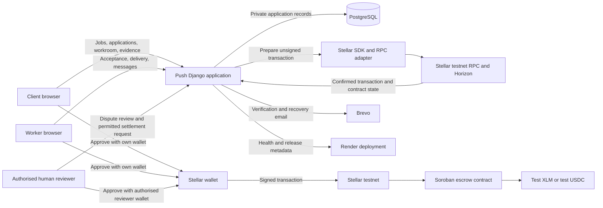
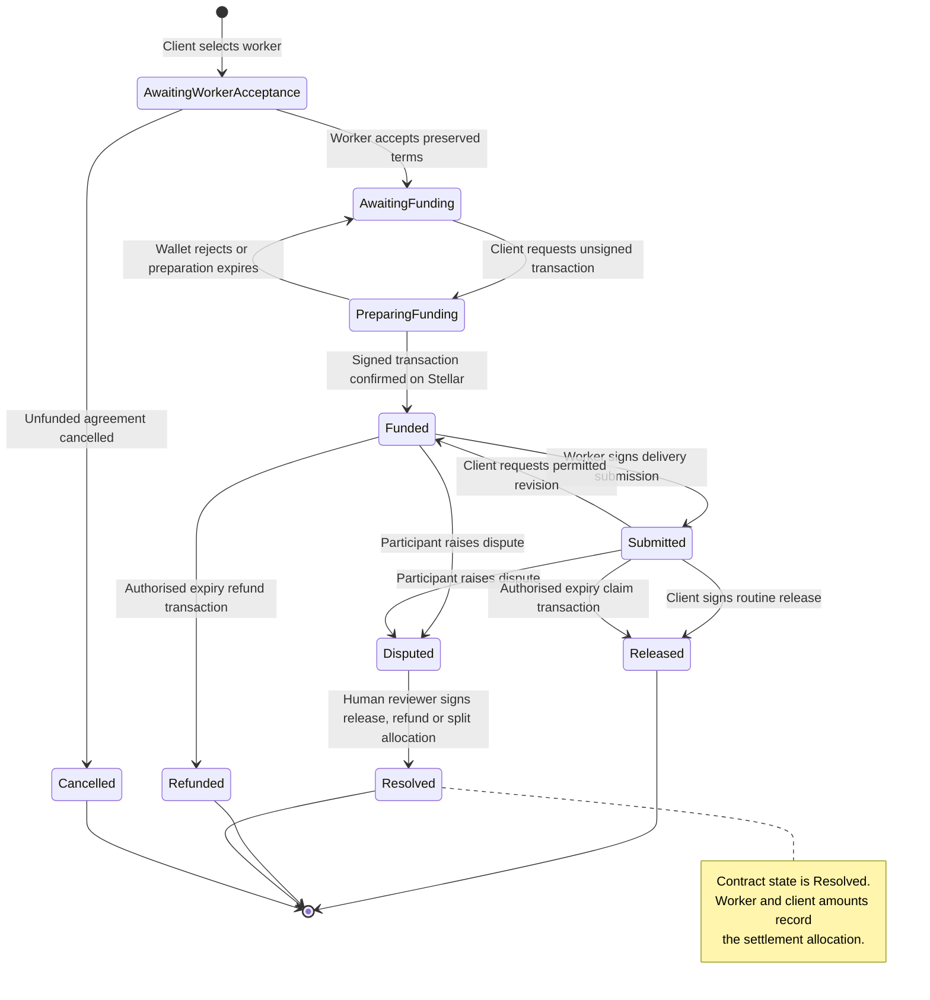

# Push architecture and financial state flows

Updated 12 November 2026. This document describes the deployed Stellar testnet pilot. Test assets have no monetary value. It is not a mainnet readiness claim or a security audit.

## System architecture

### Trust boundaries

1. Push stores accounts, job information, accepted terms, private messages, delivery references and reconciled transaction records off chain.
2. Push does not request or store wallet private keys or recovery phrases. The relevant participant approves each transaction in their own wallet.
3. Stellar testnet is the source of truth for submitted transaction status and contract state. A button press alone never marks an agreement as funded or paid.
4. Routine release is approved by the client. Push staff do not approve every payment.
5. Disputes remain human decisions. Only an authorised reviewer wallet may sign a contract permitted release, refund or split, and a staff member who is a party to the agreement may not decide it.
6. Private work evidence remains off chain. Public addresses, amounts and contract actions remain visible on Stellar.

## Financial state model

## Financial controls

| Control | Current behaviour | Evidence location |
| --- | --- | --- |
| Asset and amount | Agreement pins an exact supported asset and token amount before funding | `core/escrow.py`, contract source and escrow tests |
| Wallet authority | Server prepares transactions; the participant or authorised reviewer signs | `core/escrow_views.py`, `core/escrow_staff.py` and wallet JavaScript tests |
| Confirmation | Application records state only after Stellar confirmation and contract reconciliation | Escrow service code and transaction records |
| Duplicate protection | Preparation reservations and idempotent reconciliation prevent concurrent duplicate actions | `core/test_escrow.py` and `core/test_escrow_staff.py` |
| Disputes | Human reviewer signs only a contract permitted settlement to the original participant wallets | Staff escrow contract and staff permission tests |
| Network fee | Fee is shown separately from escrow value and rejected above the configured safety limit | Escrow preparation tests and testnet deployment record |
| Testnet disclosure | UI and documentation state that test assets have no monetary value | Templates, README and public pilot |

## Deployed pilot

The deployed application is [https://pushearn.xyz](https://pushearn.xyz). On 12 November 2026 its health endpoint returned HTTP 200, `stellar-testnet`, `escrow_enabled: true` and release `a60af23e1bcf`.

The current recorded testnet contract is `CAO6VET6JK73QW4IJOIFCECYACWIZMC7GZK4I3G43ECSFQMCHGEKT3G5`. Its deployment and QA metadata are recorded in `contracts/deployments/testnet-owner-escrow-v4.json`.
